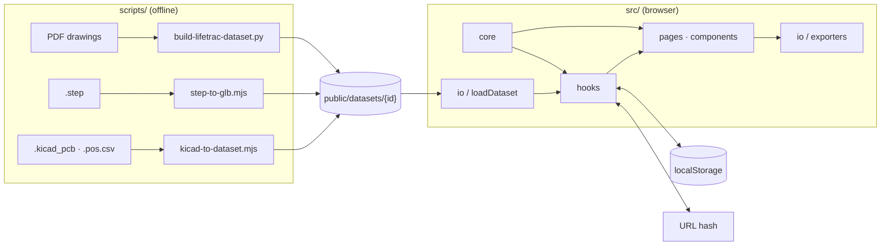

# Inspection Dashboard

[](https://inspection-dashboard.inspection-dashboard.workers.dev)
[](LICENSE)


제조 검사의 **대상 · 위치 · 기준**을 한 화면에서 확인하고 기록하는 웹 애플리케이션입니다.

데이터 폴더만 교체하면 PCB 와 용접 · 가공 도면을 같은 화면으로 다룹니다.

> [!IMPORTANT]
> 공개 데이터로 만든 예시입니다.
> 해당 분야의 현장 지식 없이 작성되어 검사 기준(공차, 확인 방법)이 검증되지 않았습니다.
> 실사용 전 전문가 검토가 필요합니다.

## Features

| 화면 | 내용 |
|---|---|
| 현황 | 진행률, 분류별 진행, 확인할 것, 상태별 색 3D¹ |
| 검사 | 목록 · 도면 · 3D¹ · 기록, 입력 즉시 판정 |
| 성적서 | 요약, 불합격 상세, 전체 판정표, 인쇄 / PDF |

¹ `meta.json` 에 3D 모델(`model`)이 있는 데이터만

- 규칙 기반 판정: 도면 치수 ± 공차 또는 고정 범위 (AI 영상 판정 없음)
- 항목 구분: `측정` · `육안` · `자동`
- 자동 처리: 해당 없는 항목 제외, 데이터 간 일치 비교, 1번 패드 위치 표시(CAD 데이터)
- 기록: localStorage, undo 30단계, CSV / JSON 입출력
- 딥링크: `#/<data>/<page>/<ref>`

## Getting started

```bash
npm install
npm run dev            # http://localhost:5173
npm test               # unit + e2e
npm run build          # dist/
npx wrangler deploy    # Cloudflare Workers
```

E2E 최초 실행 전 `npx playwright install chromium` 이 필요합니다.

## Architecture



| Layer | Path | Role |
|---|---|---|
| core | `src/core/` | 판정, 자동 비교, 순서, undo (pure, unit-tested) |
| io | `src/io/` | 데이터 로드 · 검증, CSV / JSON 내보내기, 설정 저장 |
| hooks | `src/hooks/` | 라우팅, 데이터 로드, 검사 기록, 단축키 |
| ui | `src/pages/`, `src/components/` | 현황 · 검사 · 성적서, 도면, 3D |

## Data

| ID | Source | License |
|---|---|---|
| `pcb-lightsabre` | [Darmur/lightsabre-dac](https://github.com/Darmur/lightsabre-dac) @ `506f15e` | CC0 1.0 |
| `lifetrac-iii` | [OSE LifeTrac III Fabrication Drawings](https://commons.wikimedia.org/wiki/File:Open_Source_Ecology_-_LifeTrac_-_Fabrication_Drawings.pdf) | CC BY-SA 3.0 |

- **PCB**: KiCad 원본(`.kicad_pcb`, `.pos.csv`, `.step`)에서 자동 변환
  - 156 parts (검사 대상 137)
  - 3D 부품 매칭 137 / 137 (패키지 기준 매칭 위치 오차 최대 0.108 mm)
- **LifeTrac**: 스캔 PDF 52장
  - 치수 · 용접 위치는 수작업 판독
  - 원본 도면 결함 4건은 `review` 열에 기록
- 검사 기준(`recipes.json`)은 이 프로젝트에서 작성
- 파일별 출처: `public/datasets/*/README.md`

데이터 생성:

```bash
node scripts/kicad-to-dataset.mjs <board>.kicad_pcb public/datasets/<id> [<board>.pos.csv]
node scripts/step-to-glb.mjs <board>.step public/datasets/<id>
python scripts/build-lifetrac-dataset.py <LifeTrac>.pdf public/datasets/lifetrac-iii
```

- KiCad · STEP 변환은 다른 기판에도 사용할 수 있습니다.
- PDF 변환은 LifeTrac 전용입니다. 판독 값이 스크립트에 들어 있으며 `pymupdf`, `pillow` 가 필요합니다.
- 기존 `recipes.json` 은 덮어쓰지 않습니다.

## Docs

- [사용 방법](docs/user-guide.md)
- [데이터 형식](docs/dataset-schema.md)

## License

| Scope | License |
|---|---|
| Source code | [MIT](LICENSE) |
| `public/datasets/pcb-lightsabre/` | [CC0 1.0](public/datasets/pcb-lightsabre/LICENSE) |
| `public/datasets/lifetrac-iii/` | [CC BY-SA 3.0](https://creativecommons.org/licenses/by-sa/3.0/) |

`occt-import-js`(LGPL-2.1)는 `scripts/step-to-glb.mjs` 전용 개발 의존성이며 `dist/` 에 포함되지 않습니다.
